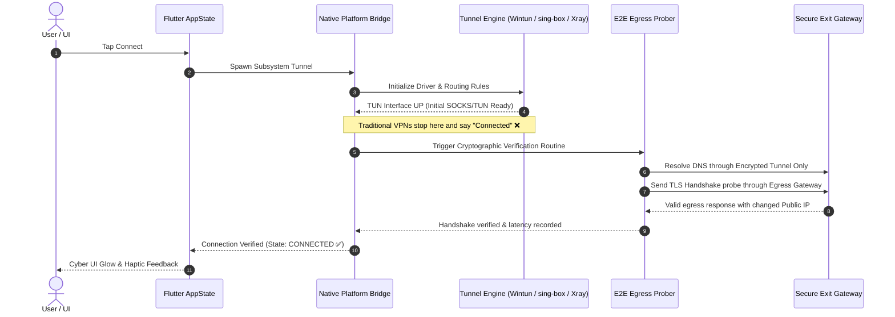

<div align="center">


<p align="center">
  <strong>Cross-Platform · Multi-Core · True Traffic Verification · Zero Leakage</strong>
</p>

[](https://github.com/harmoneyvpn/Harmoney-VPN/releases)
[](https://github.com/harmoneyvpn/Harmoney-VPN/actions)
[](LICENSE)
[](#-platform-support-matrix)
[](https://flutter.dev)

<br/>

[🌟 Features](#-key-features--capabilities) •
[🏗️ Architecture](#️-architecture--truth-in-connection) •
[⚡ Quick Start](#-quick-start--installation) •
[🛠️ Build Guide](#️-compilation--build-from-source) •
[🛡️ Security Center](#-security--leak-shield-suite) •
[🤝 Contributing](#-contributing)

</div>

---

## ⚡ What is Harmoney VPN?

**Harmoney VPN** is an elite, cross-platform VPN and anti-censorship tunnel suite crafted with **Flutter, Rust, Go, and C++**. Engineered specifically for restrictive network environments, severe DPI censorship, and hostile network nodes, Harmoney departs from traditional VPN clients with one core philosophy:

> 💡 **"Truth in Connection"**: Never declare a connection successful based on a running daemon, an open SOCKS port, or a spawned interface. **A tunnel is only connected if, and only if, encrypted data demonstrably traverses the exit gateway and IP provenance is cryptographically confirmed.**

---

## ✨ Key Features & Capabilities

<table>
  <tr>
    <td width="50%">
      <h3 align="left">🚀 Multi-Engine Matrix</h3>
      <ul>
        <li><b>Harmoney Smart Core:</b> Autonomous intelligent routing across <code>VLESS</code>, <code>VMess</code>, <code>Trojan</code>, <code>Shadowsocks</code>, <code>MASQUE</code>, and <code>WARP</code>.</li>
        <li><b>FireTunnel Core:</b> First-class Mozilla Guardian / Firefox VPN integration with native headless OAuth token exchange.</li>
        <li><b>WireGuard & OpenVPN:</b> Complete native profile manager supporting <code>.conf</code>, <code>.ovpn</code>, and bulk <code>.zip</code> archive imports.</li>
        <li><b>Harmoney Pro / Harmoney Plus:</b> Integrated multi-hop relay and enterprise Cisco AnyConnect protocol compatibility.</li>
      </ul>
    </td>
    <td width="50%">
      <h3 align="left">🛡️ Zero-Leak Defense</h3>
      <ul>
        <li><b>Kernel-Level Kill Switch:</b> Instant network cutoff via Windows WFP, Linux nftables, and Android VpnService lockdown.</li>
        <li><b>Smart DNS Resolver:</b> Selectable encrypted DNS engines (<b>Cloudflare</b>, <b>Google</b>, <b>AdGuard</b>, <b>Shecan</b>, <b>Quad9</b>) or custom DoH/DoT endpoints.</li>
        <li><b>IPv6 Blackholing:</b> Eliminates location leakage through unrouted IPv6 pathways.</li>
        <li><b>Emergency Hardware Unjam:</b> One-click restore button for interfaces, firewall routes, and XFRM states.</li>
      </ul>
    </td>
  </tr>
  <tr>
    <td width="50%">
      <h3 align="left">🌐 Granular Traffic Steering</h3>
      <ul>
        <li><b>Per-App Split Tunneling:</b> Choose exactly which applications route through the tunnel and which bypass it.</li>
        <li><b>LAN & Intranet Bypass:</b> Seamlessly interact with local printers, smart TVs, and NAS devices without dropping the tunnel.</li>
        <li><b>Domestic Services Bypass:</b> Auto-detects local banking and government services via CIDR routing tables to avoid unnecessary slowdowns.</li>
        <li><b>Adaptive MTU Optimizer:</b> Presets for <code>1420</code>, <code>1380</code>, and <code>1500</code> bytes to eliminate packet fragmentation over mobile carriers.</li>
      </ul>
    </td>
    <td width="50%">
      <h3 align="left">💎 Modern Cyber Experience</h3>
      <ul>
        <li><b>Ultra-Modern Cyber UI:</b> Glassmorphism design system built with fluid animations and responsive layout.</li>
        <li><b>Sub-system Desktop Integrations:</b> Windows system tray, Linux Ayatana AppIndicator, and Android ongoing control notifications.</li>
        <li><b>Real-Time Talker Logs:</b> Deep interactive debugging console with level filters, search, and instant trace exports.</li>
        <li><b>Bilingual Localization:</b> Complete English and Persian (فارسی) support with dynamic RTL/LTR directionality.</li>
      </ul>
    </td>
  </tr>
</table>

---

## 🏗️ Architecture & "Truth in Connection"

Most VPN apps mark their status as "Connected" the millisecond a local TUN device starts listening. Harmoney’s multi-layered verification engine ensures zero false positives:



---

## 📊 Platform Support Matrix

| OS Platform | Minimum Target | Subsystem Backend | Kill Switch Engine | Tray / Background | Status |
|:---|:---|:---|:---|:---|:---:|
|  **Android** | Android 7.0+ (API 24+) | Native `VpnService` + GoMobile / tun2socks | Native Android Lockdown | Notification + Widget |  |
|  **Windows** | Windows 10 / 11 (64-bit) | Wintun Driver + Xray Core + FFI | Windows Filtering Platform (WFP) | System Tray Minimized |  |
|  **Linux** | Ubuntu 22.04+, Debian, Arch, Fedora | `sing-box` 1.12+ / `systemd` daemon | `nftables` Policy Routing | Ayatana AppIndicator |  |
|  **macOS** | macOS 12+ (Monterey) | NetworkExtension + Rust FFI | PacketFilter (PF) | Status Menu Bar |  |

---

## 🚀 Quick Start & Installation

Pre-compiled binary releases for all supported operating systems are available directly on our [Releases Page](https://github.com/harmoneyvpn/Harmoney-VPN/releases).

### 📱 Android
Download the latest `app-release.apk` (or architecture-specific `arm64-v8a`) and install on your Android device.

### 🪟 Windows
Download `harmoney-windows-x64.zip`, extract, and execute `harmoney_vpn.exe`. *Administrator privilege is prompted at first run to configure Wintun virtual adapters.*

### 🐧 Linux
Clone and execute our privileged daemon installer:
```bash
sudo bash scripts/install-harmoney.sh
harmoney-vpn
```

---

## 🛠️ Compilation & Build from Source

### 1. Prerequisites
Ensure you have the following toolchains installed:
- [Flutter SDK](https://flutter.dev) (v3.24.0 or newer)
- [Git](https://git-scm.com)
- Compiler toolchains for your host OS:
  - **Windows**: Visual Studio 2022 (*Desktop development with C++*)
  - **Linux**: GCC/Clang, CMake, Ninja, GTK3 Dev libraries
  - **Android**: Android SDK & NDK 25+

### 2. Clone & Setup Workspace
```bash
git clone https://github.com/harmoneyvpn/Harmoney-VPN.git
cd Harmoney-VPN/apps/flutter
flutter pub get
```

### 3. Build Targets

<details>
<summary><b>📱 Build Android APK / AppBundle</b></summary>
<br/>

```bash
# Universal Release APK
flutter build apk --release

# Split APKs per ABI (arm64-v8a, armeabi-v7a, x86_64)
flutter build apk --release --split-per-abi

# Production Google Play App Bundle
flutter build appbundle --release
```
</details>

<details>
<summary><b>🪟 Build Windows Desktop</b></summary>
<br/>

```bash
flutter build windows --release
```
*Executables and bundled native DLLs (Wintun, Xray, OpenConnect) are placed in `build/windows/x64/runner/Release/`.*
</details>

<details>
<summary><b>🐧 Build Linux Desktop</b></summary>
<br/>

Install build prerequisites:
```bash
sudo apt-get update && sudo apt-get install -y \
  clang cmake ninja-build pkg-config \
  libgtk-3-dev libayatana-appindicator3-dev \
  liblzma-dev libstdc++-12-dev
```

Run build:
```bash
flutter build linux --release
```
</details>

---

## ⚙️ Compilation Environment Variables

Harmoney supports custom compile-time configuration through Flutter `--dart-define`:

```bash
flutter build <platform> --release \
  --dart-define=HARMONEY_PRO_DOWNLOAD_URL=https://your-custom-pro-endpoint.com \
  --dart-define=TALKER_LOGS_ENABLED=true
```

| Environment Variable | Type | Default | Description |
|:---|:---:|:---:|:---|
| `HARMONEY_PRO_DOWNLOAD_URL` | `String` | `null` | URL target for downloading upgraded Pro editions. |
| `TALKER_LOGS_ENABLED` | `bool` | `true` | Embeds the interactive Talker diagnostic console into the app. |

---

## 🔬 In-App Diagnostics (Talker Console)

Harmoney features an on-device technical telemetry console powered by [Talker](https://pub.dev/packages/talker_flutter). No external logger required:

* 🔎 **Real-Time Stream:** Live logs for route updates, DNS resolutions, WFP filters, and tunnel state changes.
* 🏷️ **Log Filtering:** Isolate critical warnings, network errors, or debug info with a single tap.
* 📋 **Zero-Knowledge Export:** Anonymizes user details before copying logs to clipboard or saving as an encrypted bundle for developer support.

> Navigate to **Settings** → **Technical Logs & Diagnostics** → **Open Console** to access.

---

## 🤝 Contributing

We welcome pull requests, vulnerability reports, and protocol enhancements from security researchers and developers worldwide!

1. **Fork** this repository.
2. Create your dedicated branch:
   ```bash
   git checkout -b feature/cyber-routing-enhancement
   ```
3. Commit clean, atomic changes:
   ```bash
   git commit -m "feat(engine): optimize sing-box handshake validation"
   ```
4. Push your branch:
   ```bash
   git push origin feature/cyber-routing-enhancement
   ```
5. Submit a **Pull Request** targeting `main`.

---

## 📄 License & Intellectual Property

* **Harmoney VPN** is free and open-source software distributed under the terms of the **[MIT License](LICENSE)**.
* Embedded protocols and third-party drivers (`Wintun`, `sing-box`, `Xray-core`, `OpenVPN`, `WireGuard`, `tun2socks`) are licensed under their respective original project licenses (GPL, MIT, Apache, BSD).

---

<div align="center">

<br/>

**Crafted with precision & passion by [Harmoney](https://github.com/harmoneyvpn) and the Global Open-Source Community.**

<sub>Empowering unrestricted, private, and resilient internet access everywhere.</sub>

<br/>


</div>
